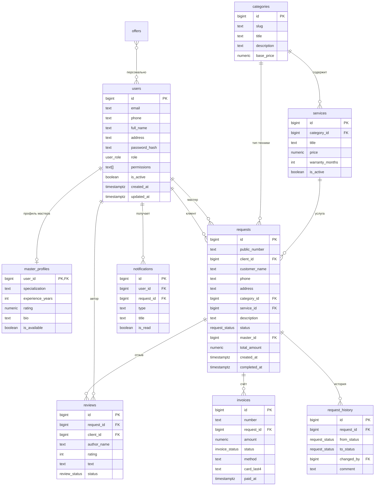

# База данных «pro-remont»

СУБД: PostgreSQL 14+. Схема создаётся миграцией
`internal/store/migrations/001_init.sql` при старте сервера.

## ER-диаграмма



## Перечисления

| Тип | Значения |
|---|---|
| `user_role` | `client`, `master`, `manager`, `admin` |
| `request_status` | `new`, `accepted`, `assigned`, `in_progress`, `ready`, `completed`, `paid`, `cancelled` |
| `invoice_status` | `pending`, `paid`, `failed`, `refunded` |
| `review_status` | `pending`, `approved`, `rejected` |

## Таблицы

### `users`
Учётные записи всех ролей. Контакт — email и/или телефон (CHECK).
Уникальные индексы по `lower(email)` и `phone`. Пароль — bcrypt.
`permissions` — массив прав для сотрудников (администратор всегда имеет все).
`is_active=false` — архивирование при удалении.

### `master_profiles`
Дополнительные данные мастера: специализация, стаж, рейтинг, биография,
ручная доступность. Доступность для назначения вычисляется как
`is_available AND нет активных заявок`.

### `categories` и `services`
Категории техники (стиральные машины, холодильники и т.д.) и услуги
прайс-листа. `base_price` категории используется, если клиент не выбрал
конкретную услугу. `warranty_months` — гарантия на работу.

### `requests`
Заявка на ремонт. Может быть создана гостем (`client_id IS NULL`) или
клиентом. Номер `public_number` формируется триггером `PR-ГГГГ-NNNNNN`.
`status` меняется только через API с проверкой допустимых переходов.
`total_amount` фиксируется при создании и может быть изменена менеджером.

### `request_history`
Аудит статусов: кто, когда, из какого в какой статус и с каким комментарием
перевёл заявку. Используется для таймлайна в карточке заявки.

### `invoices`
Счёт по заявке, один к одному (`UNIQUE request_id`). Номер `INV-ГГГГ-NNNNNN`
формируется триггером. Хранит способ оплаты, последние 4 цифры карты,
код операции и время оплаты.

### `reviews`
Отзывы клиентов. Для отзыва по заявке — уникальный индекс
`reviews_request_uq`, поэтому повторный отзыв по одной заявке невозможен.
Новые отзывы попадают в `pending` и публикуются после модерации.

### `offers`
Скидки: `audience` = `all` / `new` / `loyal`, `min_orders` — порог по истории.
Персональные предложения вычисляются в `GET /api/offers/personal`.

### `notifications`
Внутренние уведомления пользователям: назначение мастера, готовность,
оплата, новые заявки для менеджеров. `is_read` — флаг прочтения.

### `theme_config`
Одна строка (`id=1`) с JSONB-черновиком и опубликованной темой CMS
(цвета, заголовки, текст подвала).

### `session_drafts`
Временные черновики реквизитов гостя на 24 часа, привязаны к cookie
`pro_draft` (HttpOnly).

## Триггеры и индексы

- `set_updated_at` — обновляет `updated_at` у `users`, `services`, `requests`;
- `assign_request_number` — генерирует номер заявки до вставки;
- `assign_invoice_number` — генерирует номер счёта;
- индексы по клиенту, мастеру, статусу и датам создания заявок;
- индекс по `notifications(user_id, is_read, created_at)`;
- индекс по `request_history(request_id, created_at)`;
- частичный уникальный индекс по email (без учёта регистра) и телефону.

## Демо-данные

Seed выполняется только если таблица `users` пуста:
6 пользователей (админ, менеджер, 3 мастера, клиент), 6 категорий,
20 услуг, 5 заявок в разных статусах, счета, 5 отзывов, 3 спецпредложения,
уведомления и тема по умолчанию.

Сбросить базу:

```powershell
# остановить сервер, затем
dropdb -h 127.0.0.1 -p 55432 -U postgres --force pro_remont
createdb -h 127.0.0.1 -p 55432 -U postgres pro_remont
# запустить сервер — миграции и seed применятся заново
```
